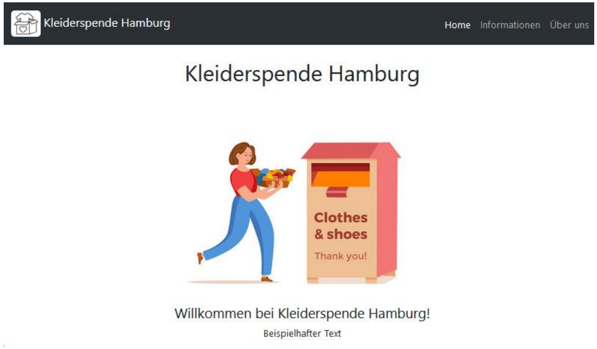
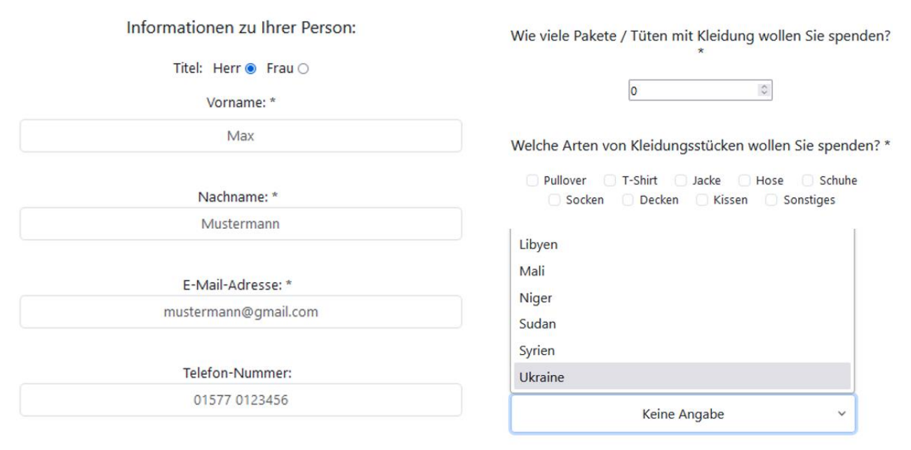
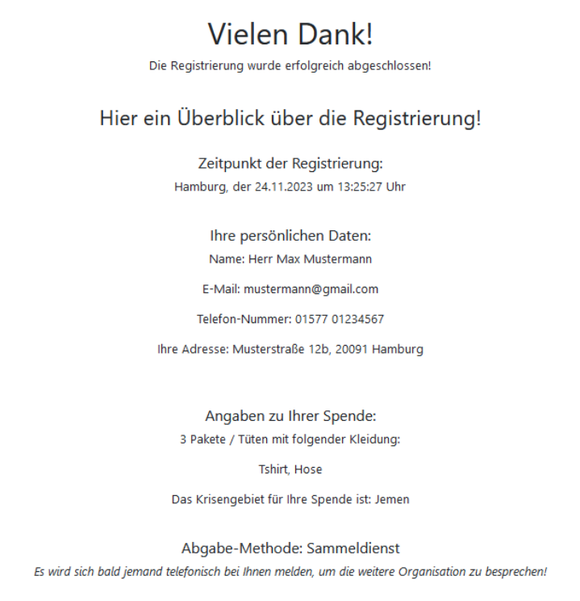
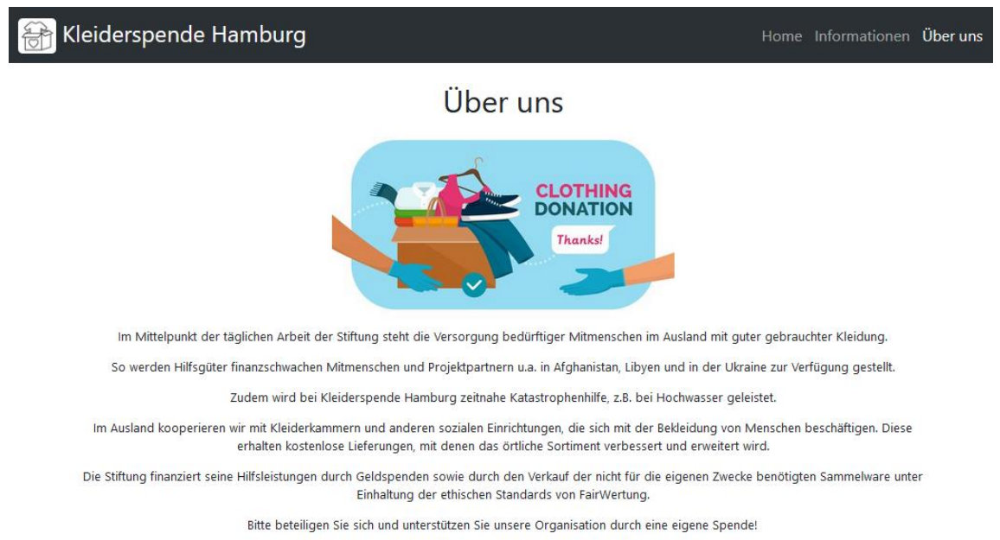
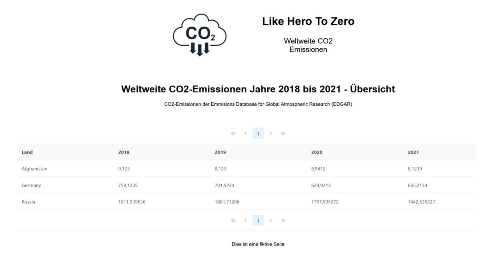
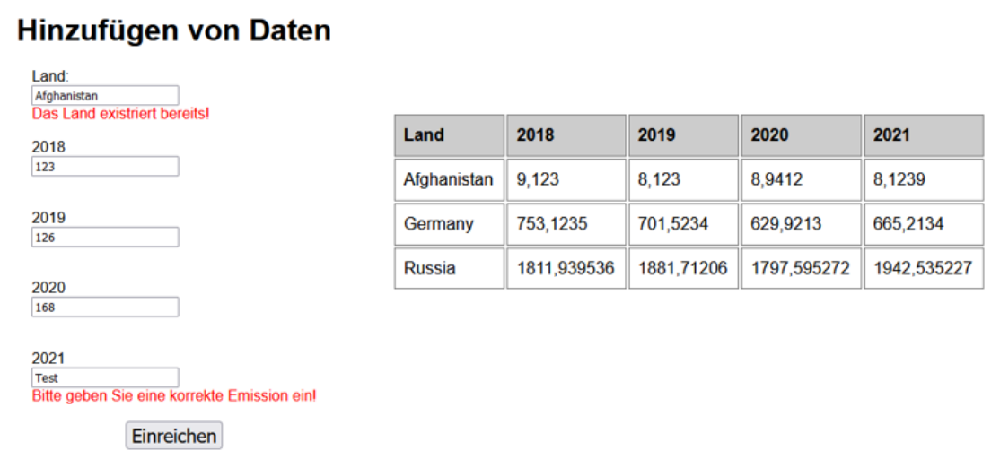

# Web Application Case Studies

Two case studies from my Bachelor of Science in Computer Science at IU International University of Applied Sciences (2023). Both projects are fictional prototypes and not meant for productive use.

| Project | Module | Technologies |
|---|---|---|
| [1. Kleiderspende Hamburg](#1-kleiderspende-hamburg) | Programming of Web Application Interfaces (IPWA01-01) | HTML, CSS, JavaScript, Bootstrap |
| [2. Like Hero To Zero](#2-like-hero-to-zero) | Programming of Industrial Information Systems with Java EE (IPWA02-01) | Java EE, JSF, PrimeFaces, MySQL |

---

## 1. Kleiderspende Hamburg

A website for a fictional non-profit organization that collects clothing donations for crisis regions. Donors register their donation through a form and can choose the crisis region and how the donation is handed over.

  

### Features

- **Multi-page website** with header, navigation, content area and footer (pages: Home, Information, About us, privacy policy, imprint)
- **Registration form** for personal data, number of packages, types of clothing and crisis region
- **Two hand-over options:** pick-up by a collection vehicle or personal drop-off at the office. The form adapts to the choice.
- **Form validation** in the browser, e.g. required fields, patterns and at least one type of clothing. For pick-ups, the address must be in the office's area (the first two digits of the postcode must match).
- **Confirmation page** that shows the registration data after submitting
- **Responsive design** for desktop and mobile devices

### Technical notes

- Built with plain HTML, CSS and JavaScript, plus Bootstrap for layout and components
- Data is passed between the pages with the browser's **Local Storage**
- The confirmation page uses `.innerText` instead of `.innerHTML` to protect against **XSS**

### Screenshots

| Registration form | Confirmation page |
|:---:|:---:|
|  |  |

  

### Limitations

- The data is only stored in the browser. A real application would need a server and a database, and the form should send the data with `POST`.
- HTTPS and further server security would be needed for real use.

---

## 2. Like Hero To Zero

A web front end for worldwide CO₂ emissions. Everyone can view the data. Registered users can log in to change and extend it. The prototype shows the emissions of the years 2018 to 2021, based on the public EDGAR dataset of the European Commission.

  

### Features

- **Public overview** of CO₂ emissions per country, shown in a PrimeFaces data table
- **Login** for registered users
- **Edit, delete and add** emission data with validation (for example, a country can only be added once and emissions must be valid numbers)
- **Persistent storage** in a MySQL database

### Technical notes

- Java EE with **JSF** (XHTML pages and beans) and **PrimeFaces**
- Maven project in Eclipse, running on an Apache **Tomcat** server
- **MySQL** with **EclipseLink** (ORM) and Data Access Objects (DAO) for emissions and users
- Development in two steps: first a prototype with an in-memory list, then the connection to the database

### Screenshots

  

### Limitations

- Pages can be opened directly through the URL, which bypasses the login.
- Navigation with buttons and the `outcome` attribute is only a simple solution.
- Registered users change or delete data directly. There is no approval process.

---

## Author

Jule Engel
